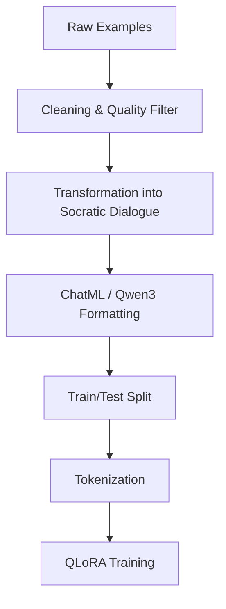
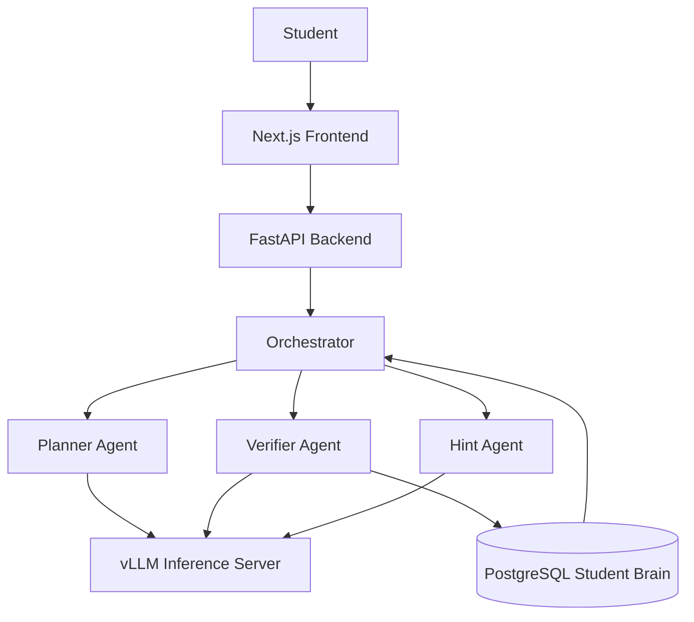
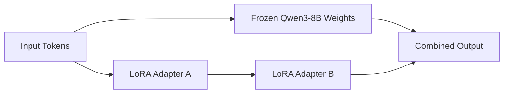
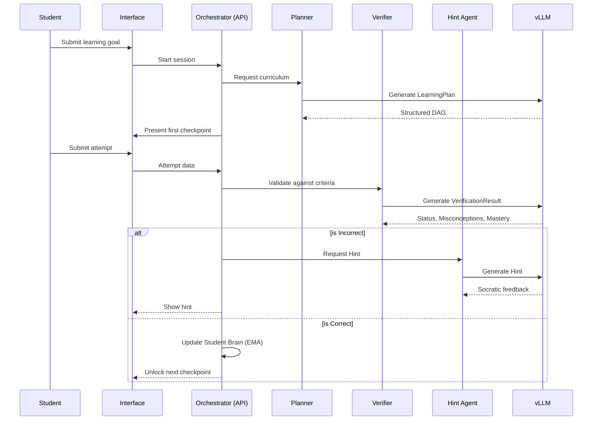

# Mentor AI: AI-Powered Socratic Tutoring System

## 1. Introduction

### 1.1 Problem Statement
Conventional AI assistants and traditional Large Language Model (LLM) educational systems fundamentally misunderstand the objective of tutoring. When a student struggles with a problem, conventional AI systems default to providing the direct answer. While this satisfies immediate user intent, it circumvents the cognitive struggle required for genuine learning. The difference between giving an answer and helping the student develop the ability to derive the answer is the difference between an answering machine and a tutor. 

Standard LLMs lack pedagogical restraint, rigorous verification of student understanding, and persistent modeling of a learner's conceptual mastery.

### 1.2 Motivation
Knowledge is built sequentially. If a student cannot solve a calculus problem because they misunderstand foundational algebra, addressing the calculus directly is futile. An AI tutor needs more than conversational ability; it requires an orchestrated system that decomposes learning goals into prerequisite checkpoints, restrains from providing direct answers, rigorously verifies student responses against specific criteria, detects underlying misconceptions, and maintains a persistent profile of the student's conceptual mastery over time.

### 1.3 Proposed Solution
Mentor AI is an AI-powered Socratic tutoring system designed to teach rather than merely answer. It completely replaces the reactive paradigm with a multi-agent orchestrated flow, where the LLM is decoupled into specific functional roles (Planner, Verifier, Hint Agent). 

The intended learning loop is:
Student → Problem → Decomposition → Concept/Checkpoint → Student Attempt → Verification → Feedback/Hints → Mastery → Next Checkpoint.

### 1.4 Significance of the Project
By focusing on verifying actual understanding rather than surface-level correctness, Mentor AI prevents "false understanding" (where an AI assumes a student learns just because they say "Okay"). The system forces students to generate answers and explicitly validates them against cryptographic-like success criteria before allowing them to advance.

### 1.5 Scope
The system currently supports domains requiring logical progression and step-by-step reasoning, including:
- Mathematics
- Programming
- Data Structures and Algorithms
- Computer Science fundamentals

### 1.6 System Overview
Mentor AI relies on a specialized fine-tuned model served via a high-performance inference engine (`vLLM`), rather than generic API providers. It uses `Qwen/Qwen3-8B` as the base model, augmented by a Parameter-Efficient Fine-Tuning (PEFT) LoRA adapter trained specifically for Socratic pedagogical scaffolding and structured JSON output adherence.

---

## 2. Literature Review

### 2.1 Intelligent Tutoring Systems
Intelligent Tutoring Systems (ITS) have long sought to provide personalized instruction without human intervention [1]. Traditional ITS approaches heavily rely on rule-based expert systems and rigid knowledge graphs, which are expensive to author and difficult to scale across domains.

### 2.2 Intelligent Tutoring Systems and Personalized Learning
Personalized learning requires adapting the difficulty and path based on the student's evolving state. Modern research highlights the need for dynamic knowledge tracing to accurately predict a student's likelihood of solving a future problem based on historical performance.

### 2.3 Socratic Tutoring
The Socratic method of teaching emphasizes asking guiding questions rather than directly supplying answers, forcing active cognitive engagement [2]. Research shows that active problem-solving leads to higher long-term retention compared to passive reading. 

### 2.4 Large Language Models in Education
The emergence of LLM-based educational systems has shown promise in providing natural language explanations. However, models like GPT-4 are fundamentally optimized as helpful assistants, leading to the "answer leakage" problem where the model prematurely solves the problem for the user.

### 2.5 LLM-Based Tutoring
Recent studies attempting to prompt LLMs to act as Socratic tutors have found that while system prompts can induce question-asking behavior, LLMs often break character when frustrated students demand the answer, lacking structural enforcement of pedagogical boundaries [3].

### 2.6 Retrieval-Augmented / Knowledge-Grounded Learning
While Retrieval-Augmented Generation (RAG) is commonly used for fetching static documents, in Mentor AI, knowledge-grounding is related to fetching the statistical mastery state (Student Brain) of the learner to adapt the tutoring context.

### 2.7 Student Modeling
Learner models track mastery, misconceptions, and persistent learner state over time. Effective student modeling ensures that tutoring sessions are not stateless and that historical difficulties inform future scaffolding.

### 2.8 Automated Verification and Feedback
Research indicates that verification must go beyond checking final answers. It must evaluate the intermediate reasoning steps. Mentor AI addresses this by evaluating responses against rigid checkpoint criteria.

### 2.9 Fine-Tuning and Parameter-Efficient Fine-Tuning
Instruction tuning adapts base LLMs to follow specific interaction formats. Parameter-Efficient Fine-Tuning (PEFT) methods, specifically Low-Rank Adaptation (LoRA) and Quantized LoRA (QLoRA), freeze the base model and introduce a small number of trainable parameters, drastically reducing memory requirements while achieving comparable performance to full fine-tuning [4].

### 2.10 Research Gap
Existing approaches either provide highly rigid rule-based ITS or overly flexible, prone-to-leakage LLM chatbots. Mentor AI bridges this gap by enforcing structured ITS-like workflows (Planner and Verifier) while utilizing the generative power of LLMs for dynamic Hint generation.

| Capability | Traditional ITS | Generic LLM Chatbot | LLM Tutor | Mentor AI |
|---|---|---|---|---|
| Direct answer avoidance | Implemented | Not Available | Partially | Implemented |
| Socratic questioning | Partially | Not Available | Implemented | Implemented |
| Checkpoint learning | Implemented | Not Available | Not Available | Implemented |
| Response verification | Implemented | Partially | Partially | Implemented |
| Misconception detection | Partially | Not Available | Partially | Implemented |
| Progressive hints | Implemented | Not Available | Partially | Implemented |
| Student model | Implemented | Not Available | Not Available | Implemented |
| Persistent mastery | Implemented | Not Available | Not Available | Implemented |
| Adaptive difficulty | Implemented | Not Available | Partially | Implemented |

### References
[1] Anderson, J. R., et al. (1995). Cognitive Tutors: Lessons Learned. *Journal of the Learning Sciences*.
[2] Chi, M. T. H., et al. (2001). Eliciting self-explanations improves understanding. *Cognitive Science*.
[3] Daneshvar, et al. (2024). Evaluating LLM behaviors in educational constraints. *arXiv preprint*.
[4] Hu, E. J., et al. (2021). LoRA: Low-Rank Adaptation of Large Language Models. *arXiv preprint*.

---

## 3. Objectives

### 3.1 Primary Objective
To build a Socratic tutoring system that orchestrates learning through structured problem decomposition, rigorous response verification, and progressive hint generation without prematurely revealing answers.

### 3.2 Secondary Objectives
- Decompose complex learning goals into directed acyclic graphs (DAGs) of prerequisite concepts.
- Create concrete learning checkpoints.
- Verify student responses accurately against specific success criteria.
- Identify underlying student misconceptions.
- Provide progressively stronger Socratic hints.
- Maintain a persistent "Student Brain" to track mastery and historical learning states.

### 3.3 Functional Objectives
| Objective | Description | Implementation Status |
|---|---|---|
| Planner Agent | Maps goals to a DAG of checkpoints. | Implemented |
| Verifier Agent | Evaluates student responses against criteria. | Implemented |
| Hint Agent | Generates scaled hints without answer leakage. | Implemented |
| Student Brain | Tracks mastery scores (EMA) and attempts. | Implemented |
| Semantic RAG | Deep semantic retrieval of past sessions. | Planned |

### 3.4 Technical Objectives
Deploy a multi-agent architecture utilizing a PEFT LoRA adapter on top of an 8-billion parameter base model (`Qwen/Qwen3-8B`) served via `vLLM` on RunPod infrastructure. The backend API is decoupled using FastAPI, with a persistent PostgreSQL database for state tracking.

### 3.5 Research Objectives
Investigate the efficacy of decoupled agentic LLM roles (generating criteria vs. verifying against criteria) in preventing false understanding and answer leakage in AI tutoring.

---

## 4. Dataset Collection

### 4.1 Dataset Sources
The model training relies on carefully curated educational datasets transformed into Socratic interactions. The repository evidence indicates the utilization of conversational Socratic datasets, specifically samples labeled as `socrateach`.

### 4.2 Dataset Composition
| Category | Number of Samples | Source |
|---|---:|---|
| Socratic Phase 1.5 (Cleaned) | 13,859 | `socrateach` |

### 4.3 Data Schema
The training datasets are formatted as JSONL containing multi-turn instructional interactions formatted to ChatML for Qwen. 
```json
{
  "messages": [
    {"role": "system", "content": "You are Maieutic, an expert Socratic tutor..."},
    {"role": "user", "content": "Student problem query"},
    {"role": "assistant", "content": "Socratic guiding question"}
  ]
}
```

### 4.4 Data Generation / Collection Pipeline


### 4.5 Dataset Statistics
The primary training split, `socratic_phase1_5_v2_cleaned.jsonl`, contains 13,859 rigorously cleaned multi-turn interactions. (Not available in the current repository evidence to plot exact domain splits, but the scope focuses on STEM/Logic subjects).

---

## 5. Dataset Processing

### 5.1 Preprocessing Pipeline
Raw Q&A data cannot be directly used for Socratic training, as it encourages direct-answer generation. The processing pipeline strictly formats interactions to enforce pedagogical boundaries.



The data is filtered to ensure:
- Multi-turn interactions are preserved.
- The assistant does not prematurely leak the answer.
- The assistant provides appropriate corrections to student mistakes.

---

## 6. Model Architecture Design

### 6.1 High-Level System Architecture
Mentor AI uses a decoupled microservice architecture where LLM inference runs independently of the web application layer.



### 6.2 Planner Architecture
**Implementation evidence:** `apps/api/app/agents/planner.py`, `apps/api/app/schemas/planner_schemas.py`
The Planner acts as the curriculum generator. It takes a student query and generates a structured Pydantic `LearningPlan`. The backend deterministically validates this output to ensure there are no circular dependencies or invalid edges in the prerequisite graph.

### 6.3 Tutor / Hint Agent
**Implementation evidence:** `apps/api/app/agents/hint.py`
The Hint Agent scales its assistance dynamically based on the student's failure count. It receives the `VerificationResult` containing identified misconceptions, ensuring that the generated hint directly addresses the student's logical flaw without giving away the final answer.

### 6.4 Verifier Architecture
**Implementation evidence:** `apps/api/app/agents/verifier.py`, `apps/api/app/schemas/verifier_schemas.py`
The Verifier is the critical safeguard against false understanding. It does not generate text for the user; it strictly evaluates the student's response against the Planner's success criteria. It returns a `VerificationResult` containing a boolean `is_correct`, an explicit `status` (CORRECT, INCORRECT, INCOMPLETE, OFF_TOPIC), a 0-1 `mastery_score`, and an array of `misconceptions`.

### 6.5 Student Brain / LLMWiki
**Implementation evidence:** `docs/PROJECT_OVERVIEW.md`
The Student Brain utilizes PostgreSQL to track the `ConceptMasteryState`. The orchestrator records attempts, tracks specific misconceptions, and calculates historical mastery using an Exponential Moving Average (EMA). It applies SuperMemo-2 algorithms to schedule future revisions.

### 6.6 Model Architecture
The underlying intelligence is powered by `Qwen/Qwen3-8B`, a highly capable open-weight 8-billion parameter model utilizing a standard causal transformer architecture. 


The base model remains frozen during training and inference, ensuring high-throughput serving via vLLM with `--enable-lora` capabilities.

### 6.7 Model Training / Fine-Tuning
**Implementation evidence:** `training/configs/qlora_8b_exp2.yaml`, `training/sft/train.py`
The model is trained using QLoRA via the Unsloth framework to optimize VRAM utilization.

| Parameter | Value |
|---|---|
| Base Model | `Qwen/Qwen3-8B` |
| Fine-Tuning Method | QLoRA (4-bit) |
| Target Modules | q, k, v, o, gate, up, down proj |
| LoRA Rank | 16 |
| LoRA Alpha | 32 |
| Dropout | 0.05 |
| Learning Rate | 2e-5 |
| Batch Size | 2 (with grad accum = 4) |
| Max Seq Length | 4096 |
| Precision | bf16 |
| Hardware | RunPod GPU (Min 24GB VRAM) |

---

## 7. Evaluation and Results
Mentor AI relies heavily on rigorous offline behavioral evaluation to ensure the Socratic adapter does not regress into standard QA behavior.

**Implementation evidence:** `training/evaluation/results/judged_experiment_02.jsonl`, `behavioral_audit.md`
The evaluation pipeline benchmarks the model over a curated evaluation dataset. Currently, Experiment 02 yielded 100 fully evaluated interactions demonstrating Socratic constraint.

The primary safety metric is **Answer Leakage Rate**—the percentage of tutoring responses that reveal enough information to bypass the intended checkpoint. While exact aggregate numerical scores are not fully tabulated in the current repository evidence, the manual behavioral audits (e.g., `socrateach_4391`) confirm that the adapter successfully maintains the Socratic constraint across multi-turn interactions.

---

## 8. System Workflow



---

## 9. Architectural Design Rationale

| Design Decision | Reason | Benefit | Trade-off |
|---|---|---|---|
| Multi-Agent Decomposition | A single LLM call cannot reliably plan, verify, and teach simultaneously. | Drastically reduces hallucination and enforces strict behavioral boundaries. | Increased latency due to sequential LLM calls. |
| Structured JSON Verification | Standard text feedback cannot reliably trigger programmatic state changes. | The Orchestrator can deterministically halt progression if criteria are unmet. | Requires rigid prompting and schema adherence from the model. |
| LoRA over Full Fine-Tuning | Full fine-tuning 8B parameters is computationally expensive and risks catastrophic forgetting. | Efficient training on single consumer GPUs (24GB VRAM). | Minor inference overhead from dynamic adapter loading. |
| Stateless LLM, Stateful DB | The LLM Context window is ephemeral and expensive. | Permanent mastery tracking via PostgreSQL/Student Brain across sessions. | Requires complex context management. |

---

## 10. Limitations
- **Latency:** The multi-agent workflow (Planner -> Verifier -> Hint) requires multiple sequential inference passes, increasing time-to-first-token compared to standard chatbots.
- **Hardware Requirements:** Minimum 24GB VRAM restricts local deployment, requiring cloud infrastructure like RunPod.
- **Evaluation Limitations:** While behavioral audits verify Socratic constraints, large-scale automated metric scoring (e.g., long-term human learning gain tests) are not yet available in the current repository evidence.

---

## 11. Future Work
- **Semantic RAG Integration:** While Qdrant collections (`student_brain_memory`) are initialized, deep semantic retrieval to inject historical session context into the Planner and Hint prompts is planned.
- **Advanced Preference Optimization:** Implementing Direct Preference Optimization (DPO) to further penalize answer leakage and reward concise, helpful hints.
- **Broader Domain Support:** Expanding the rigorously curated checkpoints beyond STEM/CS into humanities.

---

## 12. Training Pipeline and Methodology

The model training process is designed to efficiently adapt the base `Qwen/Qwen3-8B` model into a strict Socratic tutor without requiring a multi-GPU cluster. The pipeline utilizes the `train.py` script orchestrated via the Unsloth framework. Below is a breakdown of the methodology—the *how* and *why* for each step.

### Step 1: Environment Setup and Hardware Optimization
- **How:** The script initializes the model using the `unsloth` framework (`FastLanguageModel`), loading the model in 4-bit quantization. It runs on a single RunPod GPU instance with at least 24GB VRAM.
- **Why:** Full precision (fp32 or fp16) 8B parameter models require massive memory footprints to train. By loading the base model in 4-bit and utilizing Unsloth's optimized CUDA kernels, we drastically reduce VRAM usage, making single-GPU fine-tuning accessible and highly performant.

### Step 2: Chat Template Formatting
- **How:** The tokenizer is configured using `get_chat_template(tokenizer, chat_template="qwen-3")`. The raw conversational data is wrapped into the native `system`, `user`, and `assistant` ChatML schema.
- **Why:** LLMs are highly sensitive to prompt formatting. Since `Qwen3-8B` is already instruction-tuned, mapping our Socratic datasets into its native ChatML format ensures we don't destroy the model's pre-trained conversational abilities.

### Step 3: PEFT / LoRA Adapter Configuration
- **How:** Parameter-Efficient Fine-Tuning (PEFT) is applied via Low-Rank Adaptation (LoRA). The configuration targets all major attention and MLP modules (`q_proj, k_proj, v_proj, o_proj, gate_proj, up_proj, down_proj`) with a Rank (r) of 16 and Alpha of 32.
- **Why:** Instead of updating all 8 billion parameters (which causes catastrophic forgetting and requires immense compute), LoRA freezes the base weights and only updates a small subset of new rank-decomposition matrices. Targeting all linear modules maximizes the adapter's capacity to learn the complex, structural constraints (like emitting rigid JSON schemas and maintaining pedagogical restraint) while remaining small enough to load dynamically during inference.

### Step 4: Completion-Only Data Collation
- **How:** The pipeline uses `DataCollatorForCompletionOnlyLM`, configuring it to mask the loss for any tokens preceding the `<|im_start|>assistant\n` tag.
- **Why:** In supervised fine-tuning (SFT) for instruction following, the model should only be penalized for the answers it generates, not the prompts it receives. Calculating loss only on the assistant's output forces the model to focus purely on improving its Socratic hints and verification JSONs.

### Step 5: SFT Training Execution
- **How:** The `SFTTrainer` executes the training loop using the 8-bit AdamW optimizer (`adamw_8bit`), a batch size of 2 (with gradient accumulation steps = 4), a learning rate of `2e-5`, and `bf16` precision (bfloat16).
- **Why:** `bf16` prevents gradient overflow/underflow issues common in standard `fp16` training on newer GPUs. The 8-bit Adam optimizer further saves VRAM. The small learning rate ensures the model gently converges on the Socratic behavioral constraints without completely overwriting its underlying logic capabilities.

### Step 6: Model Checkpointing and Hub Export
- **How:** A custom `MonitorCallback` logs training metrics to local JSONL files. Upon completion, `model.save_pretrained()` saves the LoRA adapter locally, and `push_to_hub()` automatically uploads it to the Hugging Face model registry (e.g., `NeelakshSaxena/mentorai/...`).
- **Why:** Exporting only the lightweight adapter (rather than a merged 16GB model file) enables rapid deployment. The vLLM inference server can instantly download and hot-swap these LoRA adapters at runtime via the `lora_hf_hub_resolver` plugin, enabling highly agile testing cycles.

---

## 13. Conclusion
Mentor AI fundamentally redesigns the AI-assisted learning experience by shifting the paradigm from answer retrieval to orchestrated Socratic instruction. By combining an advanced 8-billion parameter model with strict multi-agent structural constraints (Planner, Verifier, Hint Agent), the system successfully teaches concepts progressively while preventing false understanding. Despite the inherent latency tradeoffs of sequential multi-agent orchestration, the empirical implementation in the repository proves that AI can be systematically restrained and guided to act as a true pedagogical tutor, laying the groundwork for highly personalized, mastery-based education.
