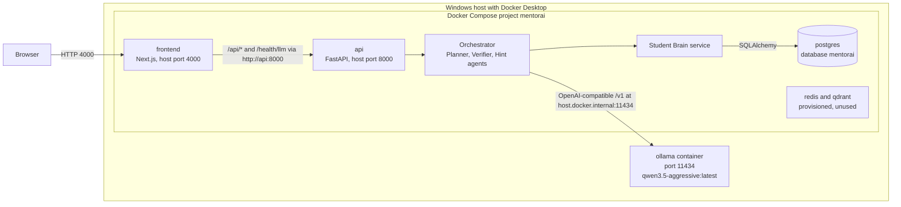
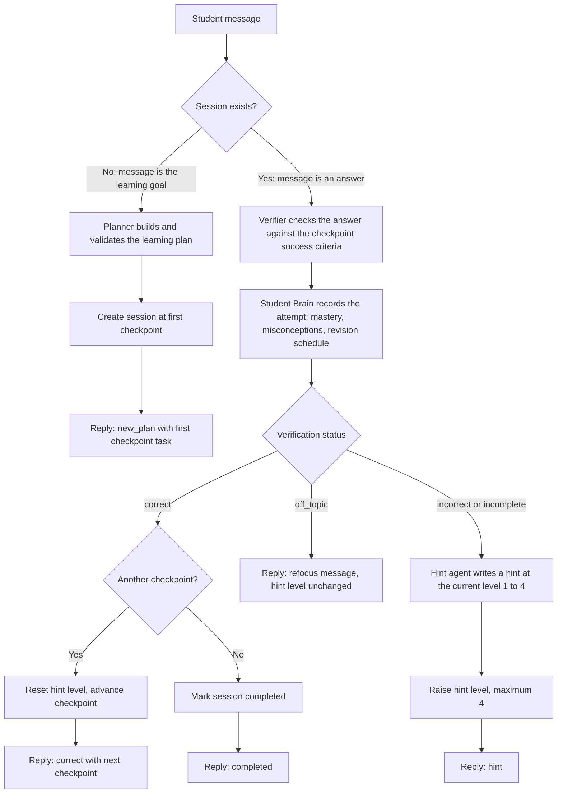

# MentorAI

MentorAI is an AI-powered Socratic tutor. Instead of answering a student's question, it breaks a learning goal into prerequisite concepts, sets checkpoint tasks, checks the student's own answers against explicit success criteria, and responds with progressive hints until the student can derive the answer. It runs locally with Docker Compose and a local Ollama model, and can also be deployed to RunPod.

- [Overview](#overview) - [Capabilities and status](#capabilities-and-status) - [Technology stack](#technology-stack) - [Architecture](#architecture) - [Learning workflow](#learning-workflow) - [Deployment modes](#deployment-modes)
- [Quick start](#quick-start-local-windows--docker-desktop) - [Health checks](#services-and-health-checks) - [Common operations](#common-operations) - [Troubleshooting](#troubleshooting-and-safety) - [Documentation index](#documentation-index) - [Repository structure](#repository-structure) - [Contributing](#development-and-contribution)

## Overview

A conventional assistant answers the question it is asked. That satisfies the immediate request but skips the effort that produces learning: a student who is handed a solution has not shown they can reach one. MentorAI separates the two. The student is guided to derive the answer; the system only advances when a checkpoint's success criteria are met.

The implemented teaching loop:

1. The student states a learning goal. A **Planner** agent turns it into a validated learning plan: concepts, prerequisite dependencies, and ordered checkpoints, each with a task and success criteria.
2. The student answers the current checkpoint task.
3. A **Verifier** agent judges the answer against the checkpoint's success criteria and reports misconceptions and a mastery score.
4. If the answer is correct, the student moves to the next checkpoint. If it is incorrect or incomplete, a **Hint** agent produces a hint at the current level (1 to 4), which rises with each failed attempt. Off-topic messages are redirected without consuming a hint level.
5. Every verified attempt updates the **Student Brain** in PostgreSQL: per-concept mastery, observed misconceptions, attempt history and a spaced-repetition schedule.

The backend, not the model, controls progression: the model proposes a verification status and the orchestrator decides what happens next. The domains targeted are mathematics, programming, data structures and algorithms, and computer science fundamentals.

## Capabilities and status

| Area | Status | Notes |
|---|---|---|
| Learning-plan generation | Implemented | Pydantic schema validation, graph validation (unknown ids, duplicates, cycles) and up to two retries that feed the error back to the model. |
| Checkpoint verification | Implemented | Structured result: per-criterion evaluation, misconceptions, mastery score, status `correct`, `incorrect`, `incomplete` or `off_topic`. |
| Progressive hints | Implemented | Four levels; the level resets on a correct answer. Hint prompt instructs the model not to reveal the answer; this is a prompt rule, not a programmatic filter. |
| Misconception handling | Implemented | Misconceptions from the verifier steer the hint and are stored per concept. There is no separate misconception-remediation agent. |
| Mastery tracking | Implemented | Exponential moving average per concept (alpha 0.3) plus an SM-2 style revision schedule, exposed at `/api/brain/{user_id}` and `/api/revision/{user_id}`. |
| Web UI | Implemented | Chat, learning-plan sidebar and mastery dashboard. The UI currently uses a fixed session (`session-default`) and user (`user-default`). |
| Local inference with Ollama | Implemented, verified | `qwen3.5-aggressive:latest` through the OpenAI-compatible `/v1` API. |
| RunPod Serverless worker and Pod HTTP mode | Implemented | Same image, selected by `RUNPOD_MODE`; see [DEPLOYMENT.md](DEPLOYMENT.md). |
| Qdrant semantic memory, Redis caching | Provisioned, not integrated | Containers run, but the application code does not use them yet. |
| Authentication, rate limiting | Not implemented | |
| Further API routes and agents (`checkpoint`, `misconception`, mastery/concept endpoints) | Placeholders | Empty module files reserved by the layout. |
| Automated CI for tests and lint | Not configured | Only the Docker image publish workflow has content. |
| Fine-tuned Socratic model | Research track | Experiment #1 adapter is frozen; see [PROJECT_STATUS](docs/PROJECT_STATUS.md) and the [training report](Socratic_Training_Report.md). Local use runs a general Ollama model instead. |

## Technology stack

| Layer | Technology |
|---|---|
| Frontend | Next.js 16 (App Router, standalone build), React 19, TypeScript 5, Tailwind CSS 4, shadcn/ui components, ESLint 9 |
| Backend | Python 3.12 image, FastAPI, Uvicorn, Pydantic 2, SQLAlchemy 2, Alembic |
| LLM integration | OpenAI Python SDK against any OpenAI-compatible endpoint (Ollama locally, vLLM on RunPod); structured JSON output validated with Pydantic |
| Data | PostgreSQL 15 in Compose; SQLite fallback when `DATABASE_URL` is unset; Redis 7 and Qdrant 1.8 provisioned but unused by the code |
| Containers | Docker Compose, [`Dockerfile.api`](Dockerfile.api), [`Dockerfile.frontend`](Dockerfile.frontend) |
| Cloud | RunPod Serverless worker (`runpod` SDK) and Pod HTTP mode |
| Tests | pytest, pytest-asyncio (30 tests) |
| Training research | Python scripts in [`training/`](training/) (QLoRA fine-tuning, dataset pipeline, evaluation) |

## Architecture

The browser only talks to the Next.js frontend. Next.js route handlers and rewrites forward requests to FastAPI inside the Compose network, and only FastAPI talks to the model server and the database. Host ports shown are those of the verified local setup.



Request path for a chat message: browser, `POST /api/chat` on the frontend, Next.js route handler ([`apps/frontend/src/app/api/chat/route.ts`](apps/frontend/src/app/api/chat/route.ts)), `POST /api/chat` on FastAPI ([`routers.py`](apps/api/app/api/routers.py)), orchestrator, model calls, database writes, response. Other `/api/*` and `/health/*` paths are forwarded by the rewrites in [`next.config.ts`](apps/frontend/next.config.ts). The API reaches Ollama through `host.docker.internal`, which Compose maps to the host gateway.

## Learning workflow

This follows [`orchestrator.py`](apps/api/app/agents/orchestrator.py).



## Deployment modes

| Mode | Backend | Frontend | LLM | Use |
|---|---|---|---|---|
| 1. RunPod only | RunPod: **Serverless** worker (`RUNPOD_MODE=serverless`, handler [`serverless_worker.py`](apps/api/app/workers/serverless_worker.py)) or **Pod** running the HTTP API | Hosted separately or on the Pod | vLLM OpenAI-compatible endpoint | Cloud deployment |
| 2. RunPod backend, local frontend | RunPod (Serverless or Pod) | Local Next.js, pointed at it with `API_INTERNAL_URL` or `RUNPOD_SERVERLESS_*` | RunPod | Frontend development against a cloud backend |
| 3. Fully local | Local Docker (`api`, `postgres`) | Local Docker (`frontend`) | Existing `ollama` container | **Recommended for local development** |

The working local setup uses the pre-existing standalone `ollama` Docker container (port 11434 published) and `qwen3.5-aggressive:latest`. The API container reaches it at `http://host.docker.internal:11434/v1`; this is the default in [`docker-compose.yml`](docker-compose.yml), so local mode needs no `.env` file. Full commands and variables for every mode are in [DEPLOYMENT.md](DEPLOYMENT.md).

## Quick start (local, Windows + Docker Desktop)

Prerequisites: Docker Desktop, an Ollama container named `ollama` that already holds `qwen3.5-aggressive:latest`, and a free host port for the UI. Details in [docs/LOCAL_DEVELOPMENT.md](docs/LOCAL_DEVELOPMENT.md).

```powershell
# 1. Start Docker Desktop if it is not running (per-user install path; otherwise use the Start menu)
docker info --format '{{.ServerVersion}}' 2>$null
if ($LASTEXITCODE -ne 0) {
    Start-Process "$env:LOCALAPPDATA\Programs\DockerDesktop\Docker Desktop.exe"
    do { Start-Sleep 5; docker info --format '{{.ServerVersion}}' 2>$null | Out-Null } until ($LASTEXITCODE -eq 0)
}

# 2. Start the EXISTING Ollama container (does not create a new one) and check the model
docker start ollama
docker exec ollama ollama list          # must list qwen3.5-aggressive:latest

# 3. Start MentorAI. Port 3000 is often taken by Open WebUI, so use 4000 for the UI
$env:FRONTEND_PORT = "4000"
docker compose up -d --build
docker compose ps

# 4. Check health, then open the UI
Invoke-RestMethod http://localhost:8000/health
Invoke-RestMethod http://localhost:8000/health/llm
Start-Process http://localhost:4000
```

If the model is missing, pull it into the `ollama` container deliberately (a large download): `docker exec ollama ollama pull qwen3.5-aggressive:latest`. If port 3000 is free you can omit `FRONTEND_PORT`; the UI is then at http://localhost:3000. Replies take roughly one to two minutes on the verified setup (a 9B model on a local GPU).

## Services and health checks

| Service | Role | Address | Verify |
|---|---|---|---|
| `frontend` | Web UI and proxy to the API | http://localhost:4000 (`FRONTEND_PORT`, default 3000) | `Invoke-RestMethod http://localhost:4000/health/llm` |
| `api` | FastAPI, orchestrator, migrations on start | http://localhost:8000 (docs at `/docs`) | `Invoke-RestMethod http://localhost:8000/health` |
| `postgres` | Learning state | internal only (`postgres:5432`) | `docker exec mentorai_postgres pg_isready -U postgres -d mentorai` |
| `redis`, `qdrant` | Provisioned, unused by the code | internal only | `docker compose ps` |
| `ollama` (separate container) | Model server | http://localhost:11434 | `docker exec ollama ollama list` |

What each signal means:

| Signal | Meaning | Does not mean |
|---|---|---|
| Container running (`docker compose ps`) | The process started. | That it is working. |
| Service healthy (`/health`, `pg_isready`) | The service answers its own probe. | That the LLM or database content is usable. |
| Model available (`/health/llm` returns ok) | The API can reach Ollama and the configured model is listed. | That the model can answer. |
| Successful inference | A real completion was produced and parsed (see runbook sections 4.3 to 4.5). | That the browser path works. |
| Browser chat works | UI, proxy, orchestrator, model and database all worked for one message. | |

Neither `/health` nor `/health/llm` runs inference. Only a real chat request does.

## Common operations

All procedures are in [docs/LOCAL_DEVELOPMENT.md](docs/LOCAL_DEVELOPMENT.md).

| Task | Section |
|---|---|
| Start, and first-time setup | [Routine startup](docs/LOCAL_DEVELOPMENT.md#2-routine-startup), [first-time setup](docs/LOCAL_DEVELOPMENT.md#1-prerequisites-and-first-time-setup) |
| Stop and restart | [Restarts and shutdown](docs/LOCAL_DEVELOPMENT.md#6-images-logs-restarts-and-shutdown) |
| Rebuild images, view logs | [Images, logs](docs/LOCAL_DEVELOPMENT.md#6-images-logs-restarts-and-shutdown) |
| Backend tests, frontend lint, type check, build, Compose validation | [Tests, lint, builds](docs/LOCAL_DEVELOPMENT.md#5-tests-lint-type-checks-and-builds) |
| Test model connectivity and a real chat | [Testing the model and chat path](docs/LOCAL_DEVELOPMENT.md#4-testing-the-model-and-the-chat-path) |
| Troubleshoot connections and missing models | [Recovery](docs/LOCAL_DEVELOPMENT.md#7-recovering-from-common-failures) |
| Preserve data, reset a session | [Data preservation](docs/LOCAL_DEVELOPMENT.md#8-data-preservation-and-session-reset) |
| Switch LLM provider or model | [Switching providers](docs/LOCAL_DEVELOPMENT.md#9-switching-llm-providers) |

Test commands at a glance (backend from the repository root, frontend from `apps/frontend`):

```powershell
$env:PYTHONPATH = "apps/api"; .\venv\Scripts\python.exe -m pytest tests -q   # 30 tests
cd apps/frontend; npm run lint; npx next typegen; npx tsc --noEmit; npm run build; cd ../..
docker compose config --quiet
```

## Troubleshooting and safety

| Problem | Remedy |
|---|---|
| Docker Desktop is stopped (`failed to connect to the docker API`) | Start it (quick start step 1). |
| Port 3000 is occupied by Open WebUI | Set `$env:FRONTEND_PORT = "4000"` before `docker compose up`. |
| Ollama container is stopped | `docker start ollama` (its restart policy is `no`). |
| Model missing in the actual Ollama instance | `docker exec ollama ollama list`; pull into that container, not another Ollama. |
| API cannot reach Ollama | `/health/llm` returns 503 with the endpoint; run the in-container check in [runbook 4.2](docs/LOCAL_DEVELOPMENT.md#42-ollama-from-inside-the-api-container). |
| PostgreSQL unhealthy | `docker compose logs postgres`, then `docker compose restart postgres`. |
| Frontend cannot reach the backend | `docker compose ps` and `docker compose logs api`; the frontend forwards to `http://api:8000`. |
| Health passes but chat fails | Health checks do not run inference. Read the error returned by `/api/chat` and the API log; see [runbook section 7](docs/LOCAL_DEVELOPMENT.md#7-recovering-from-common-failures). |
| Old persisted learning state | The UI reuses `session-default`; [reset that session](docs/LOCAL_DEVELOPMENT.md#83-reset-a-learning-session). |
| Slow responses | Expected for a local 9B reasoning model; check GPU use with `docker exec ollama ollama ps`. |

Safety:

- Never use `docker compose down -v`, `docker volume prune` or `docker system prune` as troubleshooting. They can delete the learning database and the Ollama models.
- Secrets (RunPod keys, Hugging Face tokens) belong only in git-ignored environment files (`.env`, `apps/frontend/.env.local`) or the deployment platform's secret store. Never commit them and never put them in `NEXT_PUBLIC_*` variables, which are visible to the browser.

## Documentation index

| Document | Covers | Read it when |
|---|---|---|
| [docs/LOCAL_DEVELOPMENT.md](docs/LOCAL_DEVELOPMENT.md) | Run, verify, test, troubleshoot and maintain the local stack | Setting up or operating the app |
| [DEPLOYMENT.md](DEPLOYMENT.md) | RunPod Serverless/Pod, RunPod plus local frontend, local Compose; environment variables | Deploying or changing LLM provider |
| [CLEANUP_REPORT.md](CLEANUP_REPORT.md) | Historical record of the repository cleanup | Wondering why a file was removed |
| [docs/README.md](docs/README.md) | Index of the `docs/` knowledge base | Looking for a topic |
| [docs/PROJECT_STATUS.md](docs/PROJECT_STATUS.md) | Implementation status, known limitations, what not to change | Before planning work |
| [docs/system_architecture.md](docs/system_architecture.md), [docs/ai_architecture.md](docs/ai_architecture.md) | System and agent design | Changing the backend |
| [docs/api.md](docs/api.md) | Endpoints and schemas | Calling or changing the API |
| [docs/student_brain.md](docs/student_brain.md), [docs/database.md](docs/database.md) | Mastery model and schema | Touching persistence |
| [docs/tutoring_protocol.md](docs/tutoring_protocol.md) | Pedagogical rules | Changing prompts or agent behavior |
| [docs/docker.md](docs/docker.md), [docs/ollama.md](docs/ollama.md), [docs/configuration.md](docs/configuration.md) | Containers, Ollama, settings | Changing infrastructure |
| [docs/development.md](docs/development.md), [docs/testing.md](docs/testing.md), [docs/troubleshooting.md](docs/troubleshooting.md) | Development, testing, failures | Day-to-day development |
| [docs/decisions.md](docs/decisions.md), [docs/roadmap.md](docs/roadmap.md), [docs/phases.md](docs/phases.md) | Decision records, roadmap, phase history | Understanding why and what next |
| [docs/legacy-runpod-unified-image.md](docs/legacy-runpod-unified-image.md) | Superseded single-image RunPod design | Only for historical context |
| [PROJECT_REPORT.md](PROJECT_REPORT.md) | Project report: problem, related work, design | Understanding the project's rationale |
| [Socratic_Training_Report.md](Socratic_Training_Report.md) | Dataset, training pipeline and model results | Working on fine-tuning |
| [training/README.md](training/README.md) | Training and dataset pipeline usage | Running training scripts |
| [behavioral_audit.md](behavioral_audit.md), [mathdial_consecutive_investigation.md](mathdial_consecutive_investigation.md) | Dataset audits | Data quality work |
| [RESTORE.md](RESTORE.md), [README_updated.md](README_updated.md) | Restoring the model on a RunPod GPU; adapter model card | Reproducing or publishing the adapter |
| [infrastructure/runpod/README.md](infrastructure/runpod/README.md) | RunPod training infrastructure notes (currently empty) | |

## Repository structure

```text
.
├── apps/
│   ├── api/                  FastAPI backend (pyproject.toml, alembic/)
│   │   └── app/              agents/, api/, core/ (LLM client), db/, schemas/, services/, prompts/, workers/
│   └── frontend/             Next.js app (src/app, src/components, next.config.ts)
├── tests/                    agents/, api/, pipeline/ (pytest)
├── docs/                     Knowledge base; LOCAL_DEVELOPMENT.md is the runbook
├── scripts/                  start_api.sh (container entrypoint) and RunPod helper scripts
├── training/                 Fine-tuning, dataset pipeline, evaluation
├── ai/, packages/, student-data/, infrastructure/   Planned layout (configs, schemas, RunPod notes)
├── docker-compose.yml        Local stack
├── Dockerfile.api, Dockerfile.frontend
├── .env.example              Template for RunPod modes (local mode needs no .env)
├── DEPLOYMENT.md, CLEANUP_REPORT.md, PROJECT_REPORT.md, Socratic_Training_Report.md
└── requirements.txt          Dependencies for the training pipeline tests
```

## Development and contribution

- Work on a branch; keep changes focused. Run the backend tests, `npm run lint`, `npx next typegen` then `npx tsc --noEmit`, and `docker compose config --quiet` before opening a pull request.
- Agent changes follow [docs/development.md](docs/development.md): schemas in `apps/api/app/schemas/`, prompts in `apps/api/app/prompts/`, logic in `apps/api/app/agents/`. Tests mock the LLM client.
- Do not retrain, delete or overwrite the frozen Experiment #1 adapter weights or their evaluation reports ([PROJECT_STATUS](docs/PROJECT_STATUS.md)).
- Do not commit secrets, `.env` files, or model weights. Do not add destructive volume cleanup to documentation as a routine step.
- The repository's `LICENSE` file is currently empty; confirm the intended license before redistributing.
