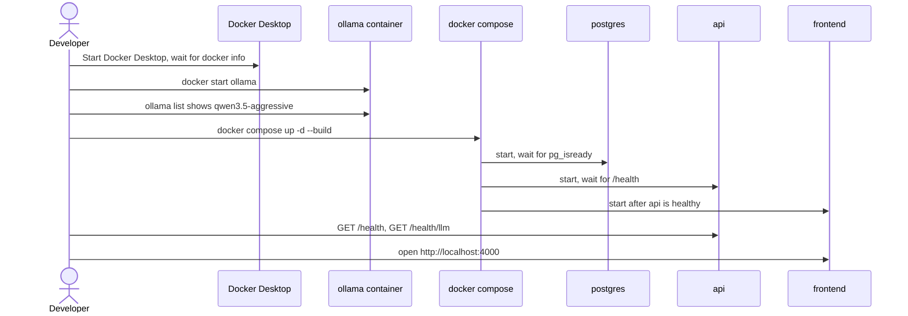

# Local Development Runbook

Detailed procedures for running, checking, testing and maintaining MentorAI locally on Windows with Docker Desktop and an existing Ollama container. The short version is in the [root README](../README.md); environment variables and the RunPod modes are in [`DEPLOYMENT.md`](../DEPLOYMENT.md).

Conventions:

- Commands are PowerShell, run from the repository root unless a step says otherwise.
- Container names come from [`docker-compose.yml`](../docker-compose.yml): `mentorai_api`, `mentorai_frontend`, `mentorai_postgres`, `mentorai_redis`, `mentorai_qdrant`. Compose service names are `api`, `frontend`, `postgres`, `redis`, `qdrant`. The model server is the separate container named `ollama`.
- Steps marked **[conditional]** only apply to a particular setup.
- Verified on Docker Compose v5, Docker Desktop (WSL 2 backend), Windows 11. Model: `qwen3.5-aggressive:latest`.

Contents: [1 Prerequisites and first-time setup](#1-prerequisites-and-first-time-setup) - [2 Routine startup](#2-routine-startup) - [3 Health checks](#3-health-checks-and-what-they-prove) - [4 Testing the model and the chat path](#4-testing-the-model-and-the-chat-path) - [5 Tests, lint and builds](#5-tests-lint-type-checks-and-builds) - [6 Images, logs, restarts and shutdown](#6-images-logs-restarts-and-shutdown) - [7 Recovery](#7-recovering-from-common-failures) - [8 Data preservation and session reset](#8-data-preservation-and-session-reset) - [9 Switching LLM providers](#9-switching-llm-providers)

## 1. Prerequisites and first-time setup

### 1.1 Prerequisites

| Requirement | Why | Check |
|---|---|---|
| Docker Desktop with Compose v2.24 or newer | Runs the whole stack. Compose 2.24+ is needed for the optional `env_file` used by the compose file. | `docker --version; docker compose version` |
| An Ollama container named `ollama`, with port 11434 published | The LLM server. Not created by this repository. | `docker ps -a --filter "name=^ollama$"` |
| The model `qwen3.5-aggressive:latest` inside that container | The tutor model. | `docker exec ollama ollama list` |
| A GPU for Ollama (practical) | A 9B model on CPU is very slow. The existing container uses the NVIDIA GPU. | `docker exec ollama ollama ps` shows `PROCESSOR` after a request |
| Node.js 20+ and npm **[conditional: only to run lint, type-check or build on the host]** | Frontend checks outside Docker. Verified with Node 24. | `node --version` |
| Python 3.11 or 3.12 **[conditional: only to run backend tests on the host]** | Backend tests. Docker images use Python 3.12. Verified with Python 3.11. | `python --version` |

### 1.2 First-time environment configuration

1. Clone the repository and open PowerShell in its root.
2. Local mode needs **no `.env` file**. [`docker-compose.yml`](../docker-compose.yml) defaults every LLM setting to `http://host.docker.internal:11434/v1` and `qwen3.5-aggressive:latest`, and its `env_file` entry is optional. This was checked by resolving the compose file with no `.env` present.
3. Do **not** copy [`.env.example`](../.env.example) to `.env` for local use: its active values are RunPod placeholders. Use it only for the RunPod modes.
4. **[conditional: port 3000 is taken, for example by Open WebUI]** Pick another host port for the MentorAI frontend. Either set it per shell:

   ```powershell
   $env:FRONTEND_PORT = "4000"
   ```

   or create a git-ignored `.env` containing only that line (skip if you already have a `.env`; append the line instead):

   ```powershell
   if (-not (Test-Path .env)) { Set-Content .env "FRONTEND_PORT=4000" }
   ```

   The variable must be present every time you run `docker compose up`, otherwise the frontend is recreated on port 3000. Port 4000 is already in the backend's default CORS list.
5. Check which ports are in use:

   ```powershell
   Get-NetTCPConnection -LocalPort 3000,4000,8000,11434 -State Listen -ErrorAction SilentlyContinue | Select-Object LocalPort, OwningProcess
   ```

   On Docker Desktop all published container ports show the Docker backend process. Compare with `docker ps --format "{{.Names}} {{.Ports}}"` to see which container owns a port.

### 1.3 First-time build

The first `docker compose up -d --build` builds both images and creates the `mentorai_*` volumes and the Postgres schema (Alembic runs in the API container on start). Subsequent starts reuse them. See [2 Routine startup](#2-routine-startup).

## 2. Routine startup



### 2.1 Start Docker Desktop

If `docker info` fails with "failed to connect to the docker API", Docker Desktop is not running.

```powershell
docker info --format '{{.ServerVersion}}' 2>$null
if ($LASTEXITCODE -ne 0) {
    # Per-user install location; otherwise start Docker Desktop from the Start menu.
    Start-Process "$env:LOCALAPPDATA\Programs\DockerDesktop\Docker Desktop.exe"
    do { Start-Sleep 5; docker info --format '{{.ServerVersion}}' 2>$null | Out-Null } until ($LASTEXITCODE -eq 0)
}
```

### 2.2 Start the existing Ollama container

Never `docker run` a second Ollama and never use `docker compose --profile bundled-ollama` while the `ollama` container is in use: both want host port 11434. The `ollama` container has restart policy `no`, so it stays stopped after Docker Desktop restarts.

```powershell
docker start ollama                 # safe if it is already running
docker ps --filter "name=^ollama$" --format "{{.Names}} {{.Status}} {{.Ports}}"
```

### 2.3 Check the model

```powershell
docker exec ollama ollama list                       # must include qwen3.5-aggressive:latest
(Invoke-RestMethod http://localhost:11434/api/tags).models.name
```

If the model is missing, it must be pulled into **this** container's volume. This is a multi-gigabyte download: do it deliberately and never as part of app startup.

```powershell
docker exec ollama ollama pull qwen3.5-aggressive:latest   # [conditional: model missing]
```

### 2.4 Start the stack

```powershell
$env:FRONTEND_PORT = "4000"        # [conditional: skip if FRONTEND_PORT is in .env or port 3000 is free]
docker compose up -d --build       # first time, and after code changes
docker compose up -d               # routine start with unchanged code
docker compose ps
```

`api` and `postgres` have health checks and `up` waits for them; `frontend` starts after `api` is healthy. `redis` and `qdrant` start but are not used by the current application code.

Open the UI at http://localhost:4000 (or the port you chose; 3000 by default).

## 3. Health checks and what they prove

Container state, service health, model availability, inference and a browser chat are five different things. Check them in order.

| Level | What it proves | Command | Healthy result |
|---|---|---|---|
| Container running | The process started | `docker compose ps` | `Up` for every service |
| Service healthy | The service answers its own probe | `Invoke-RestMethod http://localhost:8000/health` and `docker exec mentorai_postgres pg_isready -U postgres -d mentorai` | `status: ok`; `accepting connections` |
| Model available | The API can reach Ollama and the model exists | `Invoke-RestMethod http://localhost:8000/health/llm` | `status: ok` with `model` and `available_models`; HTTP 503 with a message otherwise |
| Successful inference | The model produces and the backend parses structured output | Section 4.3 and 4.4 | A parsed result |
| End-to-end browser chat | UI, proxy, orchestrator, model, database all work | Section 4.6 | An assistant reply bubble |

`/health` and `/health/llm` never run inference. `/health/llm` lists the endpoint's models and checks the configured model name is present.

### 3.1 Everything at once

```powershell
docker compose ps --format "table {{.Name}}\t{{.Status}}"
Invoke-RestMethod http://localhost:8000/health
Invoke-RestMethod http://localhost:4000/health/llm      # through the frontend proxy; use your FRONTEND_PORT
Invoke-RestMethod http://localhost:8000/health/llm      # backend directly
docker exec mentorai_postgres pg_isready -U postgres -d mentorai
docker exec ollama ollama list
```

### 3.2 Database connection and contents

```powershell
docker exec mentorai_postgres psql -U postgres -d mentorai -c "\dt"
docker exec mentorai_postgres psql -U postgres -d mentorai -c "SELECT (SELECT count(*) FROM learning_sessions) AS sessions, (SELECT count(*) FROM mastery_attempts) AS attempts, (SELECT count(*) FROM concept_mastery_states) AS mastery_states;"
docker exec mentorai_api alembic current            # expect the head revision
```

Expected tables: `users`, `student_profiles`, `concept_mastery_states`, `mastery_attempts`, `learning_sessions`, `revision_schedules`, `alembic_version`.

## 4. Testing the model and the chat path

### 4.1 Ollama directly from Windows

```powershell
Invoke-RestMethod http://localhost:11434/api/tags | Select-Object -ExpandProperty models | Select-Object name, size
```

### 4.2 Ollama from inside the API container

This is the path the application uses. Expect `200`.

```powershell
docker exec mentorai_api python -c "import urllib.request,os;print(urllib.request.urlopen(os.environ['TRANSFORM_BASE_URL']+'/models',timeout=5).status)"
```

### 4.3 A direct completion

`qwen3.5-aggressive` is a reasoning ("thinking") model. With a small `max_tokens` it can spend every token on reasoning and return an empty `content` (`finish_reason: length`), so give it room. This takes tens of seconds.

```powershell
$body = @{ model = "qwen3.5-aggressive:latest"; max_tokens = 2000
           messages = @(@{ role = "user"; content = "Reply with the single word: ready" }) } | ConvertTo-Json -Depth 4
$r = Invoke-RestMethod -Uri http://localhost:11434/v1/chat/completions -Method Post -Body $body -ContentType "application/json" -TimeoutSec 300
$r.choices[0].message.content
```

### 4.4 Inference through the backend's own client

Runs `LLMClient` inside the API container with JSON-mode parsing, using the container's real environment:

```powershell
@'
import asyncio, time
from pydantic import BaseModel
from app.core.llm_client import LLMClient
class Ping(BaseModel):
    reply: str
async def main():
    c = LLMClient()
    print("endpoint:", c.base_url, "model:", c.model)
    t = time.time()
    print("parsed:", await c.generate_structured("You are a test.", 'Return JSON {"reply": "ready"}', Ping), "in %.1fs" % (time.time() - t))
asyncio.run(main())
'@ | docker exec -i mentorai_api python -
```

### 4.5 A real chat request through the frontend-facing route

Use a **new** `session_id` each time you want a fresh plan: an existing session treats the message as an answer to its current checkpoint. A new plan is one model call (about 1 to 1.5 minutes here).

```powershell
$body = @{
  user_id    = "local-test-user"
  session_id = "local-test-$(Get-Date -Format yyyyMMddHHmmss)"
  message    = "Help me understand what a Python variable is. Teach me Socratically and ask one question at a time."
} | ConvertTo-Json
Invoke-RestMethod -Uri http://localhost:4000/api/chat -Method Post -Body $body -ContentType "application/json" -TimeoutSec 600 | ConvertTo-Json -Depth 6
```

Expected: `type` is `new_plan`, `message` contains the first task, `next_checkpoint` holds the checkpoint. Send a second request with the same `session_id` to submit an answer; the response `type` is then `correct`, `incorrect`, `incomplete` or `off_topic` (see [`api.md`](api.md)). To bypass the frontend, post the same body to `http://localhost:8000/api/chat`.

Confirm Ollama served it:

```powershell
docker exec ollama ollama ps                      # model loaded, PROCESSOR column
docker logs ollama --tail 50 2>&1 | Select-String "chat/completions"
```

### 4.6 The browser learning flow

1. Open http://localhost:4000. The header badge should show the LLM as connected.
2. The UI uses a fixed session (`session-default`) and user (`user-default`), so it continues whatever that session already contains. To start from a clean plan, reset that session first ([8.3](#83-reset-a-learning-session)) and reload the page.
3. Type a learning goal and send. A typing indicator appears until the reply arrives (up to a few minutes).
4. The Learning Plan sidebar lists checkpoints; answer the displayed task. Correct answers advance to the next checkpoint and raise the Concept Mastery figure; wrong answers return a hint; off-topic messages return "Let's try to stay focused on the current task."

This procedure was run in the Claude desktop app's built-in browser against the local stack; the first message hit the off-topic branch because the existing session already had an unrelated plan, and an on-topic answer was judged correct.

## 5. Tests, lint, type checks and builds

### 5.1 Backend tests (30 tests: agents, orchestrator, API, serverless worker, data pipeline)

Run from the repository root. `PYTHONPATH=apps/api` makes the `app` package importable; `python -m pytest` puts the root on the path for the `training` package used by `tests/pipeline`.

First-time environment **[conditional: no virtual environment yet]**. The dependency versions mirror [`apps/api/pyproject.toml`](../apps/api/pyproject.toml); [`requirements.txt`](../requirements.txt) adds what the data-pipeline tests need.

```powershell
python -m venv venv
.\venv\Scripts\python.exe -m pip install "fastapi>=0.110" "uvicorn>=0.29" "pydantic>=2.6.4,<3" "pydantic-settings>=2.2.1,<3" "sqlalchemy>=2.0.29,<3" "alembic>=1.13.1,<2" "psycopg2-binary>=2.9.9,<3" "qdrant-client>=1.8,<2" "redis>=5,<6" "httpx>=0.27,<0.28" "openai>=1.16.2,<2" "runpod>=1.12,<2" "pytest>=8.1.1,<9" "pytest-asyncio>=0.23.6,<0.24" -r requirements.txt
```

Run:

```powershell
$env:PYTHONPATH = "apps/api"
.\venv\Scripts\python.exe -m pytest tests -q
```

Expected: `30 passed`. Tests mock the LLM client, so they do not need Ollama or Docker.

### 5.2 Frontend lint, type check and production build

```powershell
cd apps/frontend
npm ci                  # [conditional: node_modules missing]
npm run lint
npx next typegen          # generates Next.js route/layout types; required before tsc on a clean checkout
npx tsc --noEmit
npm run build           # writes apps/frontend/.next (git-ignored, safe to delete)
cd ../..
```

Without `npx next typegen` (or an earlier `npm run build`), `tsc` reports `Cannot find name 'LayoutProps'` because those types are generated into `.next/types`.

### 5.3 Docker validation

```powershell
docker compose config --quiet; "rc=$LASTEXITCODE"      # expect rc=0
docker compose build                                    # builds api and frontend images
```

## 6. Images, logs, restarts and shutdown

### 6.1 Build and rebuild

```powershell
docker compose build api                 # backend only
docker compose build frontend            # frontend only
docker compose up -d --build             # rebuild changed images and recreate their containers
docker compose build --no-cache api      # [conditional: force a clean build]
```

The frontend bakes `NEXT_PUBLIC_*` values at build time (see the `args` in the compose file); rebuild it after changing them.

### 6.2 Logs

```powershell
docker compose logs -f api                              # follow one service
docker compose logs --since 10m --no-log-prefix api     # recent window
docker compose logs --tail 100 postgres
docker compose logs api 2>&1 | Select-String "POST /api/chat|Error|Traceback"
docker logs ollama --tail 100                           # the model server (not part of Compose)
```

`GET /health` lines in the API log are the container health check, not user traffic.

### 6.3 Restart individual services

```powershell
docker compose restart api               # PowerShell prints this to stderr; it is not an error
docker compose restart frontend
docker compose restart postgres          # api reconnects on its next request
```

### 6.4 Stop safely

```powershell
docker compose stop                      # stops MentorAI containers, keeps containers and volumes
docker compose start                     # starts them again
docker compose down                      # removes containers and network; named volumes are kept
docker stop ollama                       # [conditional: also free the GPU/VRAM; shared with other apps]
```

Do not use `docker compose down -v`, `docker volume prune` or `docker system prune` as routine commands: `-v` deletes the Postgres, Redis and Qdrant volumes, and the prune commands can delete the `ollama` model volume.

## 7. Recovering from common failures

| Symptom | Cause and check | Fix |
|---|---|---|
| `failed to connect to the docker API` | Docker Desktop is stopped. | [2.1](#21-start-docker-desktop) |
| `Bind for 0.0.0.0:3000 failed: port is already allocated` | Open WebUI (or another container) holds port 3000. `docker ps --format "{{.Names}} {{.Ports}}"` | Set `FRONTEND_PORT` ([1.2](#12-first-time-environment-configuration)). Do not stop Open WebUI unless you intend to. |
| `/health/llm` returns 503 "Cannot reach LLM endpoint" | The `ollama` container is stopped, or its port is not published. `docker ps --filter "name=^ollama$"` | `docker start ollama`; re-run [4.2](#42-ollama-from-inside-the-api-container). |
| `/health/llm` returns 503 "Model ... not found" | The model is not in this Ollama instance (a different Ollama, for example on Windows, does not count). | `docker exec ollama ollama list`; pull deliberately ([2.3](#23-check-the-model)); or correct `TRANSFORM_MODEL`. |
| API container cannot reach Ollama but Windows can | `host.docker.internal` unresolved or Ollama bound to loopback only. | Compose sets `extra_hosts: host.docker.internal:host-gateway`; confirm with 4.2. If Ollama runs outside Docker, bind it to `0.0.0.0` (`OLLAMA_HOST`). |
| `postgres` unhealthy / API never becomes healthy | `docker compose logs postgres`, `docker compose ps` | `docker compose restart postgres`; if the data directory is corrupt, restore from backup. Do not delete the volume as a first step. |
| Frontend shows 502 or "Proxy communication error" | The `api` container is down or unhealthy, or `API_INTERNAL_URL` is wrong. | `docker compose ps`; `docker compose logs api`; the frontend expects `http://api:8000`. |
| `/health/llm` is ok but chat returns 500 | Health does not run inference. Read the error text in the response and `docker compose logs api`. Typical causes: the model returned JSON that failed validation after retries, or a request timed out. | Retry; raise `LLM_TIMEOUT_SECONDS`; check [4.4](#44-inference-through-the-backends-own-client). |
| Chat returns 503 mentioning the endpoint | Same causes as the health 503s, but surfaced during a real request. | As above. |
| UI replies "Let's try to stay focused on the current task." to a new topic | The fixed `session-default` still holds an earlier plan, so your message was judged against its current checkpoint. This is expected behavior. | Answer the displayed task, or reset the session ([8.3](#83-reset-a-learning-session)). |
| Replies take 1 to 3 minutes | A 9B reasoning model; a wrong answer needs a verifier call and a hint call. | `docker exec ollama ollama ps` to confirm GPU use. Keep the model loaded with `OLLAMA_KEEP_ALIVE=-1` on the Ollama container if it unloads between requests. |
| Frontend shows old behavior after code changes | Stale image. | `docker compose up -d --build`. |

## 8. Data preservation and session reset

### 8.1 What must be preserved

| Data | Where | Notes |
|---|---|---|
| Learning state (sessions, attempts, mastery, revision schedules) | Docker volume `mentorai_postgres_data` | Survives `stop`, `down`, rebuilds. Destroyed by `down -v` or deleting the volume. |
| Ollama models | Docker volume `ollama` (owned by the `ollama` container, not Compose) | Re-pulling is a multi-gigabyte download. Never prune. |
| `.env`, `apps/frontend/.env.local` | Local, git-ignored | Hold secrets. Never commit. |
| SQLite files `maieutic.db`, `apps/api/maieutic.db` | Repository (tracked) | Used only when `DATABASE_URL` is unset (host runs, RunPod pods). Do not delete. |
| `mentorai_redis_data`, `mentorai_qdrant_data` | Docker volumes | Provisioned, currently unused by the application code. |
| Reports, datasets, adapters, `training/` | Repository | Research artifacts; see [CLEANUP_REPORT.md](../CLEANUP_REPORT.md). |

### 8.2 Back up the database

```powershell
New-Item -ItemType Directory -Force backups | Out-Null          # add backups/ to .gitignore if you keep it here
docker exec mentorai_postgres pg_dump -U postgres -d mentorai | Set-Content -Encoding utf8 "backups/mentorai-$(Get-Date -Format yyyyMMdd-HHmmss).sql"
```

### 8.3 Reset a learning session

This deletes one session and its recorded attempts, and leaves users, profiles, mastery states, revision schedules and every other session untouched. Replace the id; the browser UI uses `session-default`.

```powershell
$sid = "session-default"
@"
BEGIN;
DELETE FROM mastery_attempts WHERE session_id = '$sid';
DELETE FROM learning_sessions WHERE id = '$sid';
COMMIT;
"@ | docker exec -i mentorai_postgres psql -U postgres -d mentorai -v ON_ERROR_STOP=1
```

Then reload the browser. The next message creates a new plan. Accumulated mastery for the user is intentionally kept; deleting it would require deleting from `concept_mastery_states` and `revision_schedules` for that user's profile, which is not part of a session reset.

## 9. Switching LLM providers

The backend reads an OpenAI-compatible endpoint from environment variables (`TRANSFORM_*`; `JUDGE_*` is defined in compose but not used by the current code; `LLM_BASE_URL` / `LLM_MODEL` / `LLM_API_KEY` are fallbacks). `LLM_PROVIDER` is passed through but not read by the code. See [`apps/api/app/core/llm_client.py`](../apps/api/app/core/llm_client.py).

| Target | Settings |
|---|---|
| Local Ollama (default) | `TRANSFORM_BASE_URL=http://host.docker.internal:11434/v1`, `TRANSFORM_MODEL=qwen3.5-aggressive:latest`, `TRANSFORM_API_KEY=ollama` |
| A different local Ollama model | Change `TRANSFORM_MODEL`; the model must exist in the `ollama` container (`docker exec ollama ollama list`). |
| RunPod (vLLM OpenAI endpoint) | `TRANSFORM_BASE_URL=https://api.runpod.ai/v2/<ENDPOINT_ID>/openai/v1`, `TRANSFORM_API_KEY=<RunPod key>`, `TRANSFORM_MODEL=mentorai`. Template in [`.env.example`](../.env.example); full procedure in [`DEPLOYMENT.md`](../DEPLOYMENT.md). |

To apply a change: put the variables in the git-ignored `.env`, then `docker compose up -d api` and re-run [3.1](#31-everything-at-once). Frontend-side RunPod Serverless routing is activated only when `RUNPOD_SERVERLESS_ENDPOINT_ID`/`RUNPOD_SERVERLESS_URL` are set in the frontend server's environment; leave them unset locally, otherwise `/api/chat` goes to RunPod instead of your API. Never put keys in `NEXT_PUBLIC_*` variables: those are exposed to the browser.
